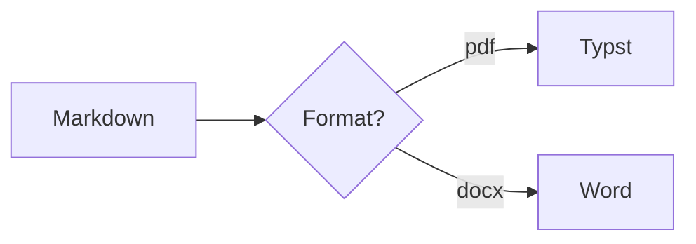

# Markdown Converter

A small self-hosted service that turns markdown into PDF, Word, and about
twenty-five other formats. Drag a file onto a web page, or POST it to an API.

Built on [pandoc](https://pandoc.org), with [Typst](https://typst.app) and
[WeasyPrint](https://weasyprint.org) as PDF engines and
[mermaid-cli](https://github.com/mermaid-js/mermaid-cli) for diagrams. Ships as
a single container.

---

## What it does

**Documents** — PDF, Word (`.docx`), OpenDocument (`.odt`), RTF
**Slides** — PowerPoint (`.pptx`), reveal.js HTML
**Web & ebook** — self-contained HTML, HTML fragment, EPUB
**Markup** — LaTeX, Typst, Markdown (GitHub/CommonMark), reStructuredText,
AsciiDoc, Org-mode, MediaWiki, DokuWiki, Textile, man, Texinfo
**Data** — DocBook, JATS, OPML, InDesign ICML, Jupyter notebook, pandoc AST,
plain text

Along the way it handles YAML front-matter, tables, footnotes, math, syntax
highlighting, task lists, a generated table of contents, and Mermaid diagrams.

`GET /api/formats` returns the live list.

---

## Quick start

```bash
git clone https://github.com/mark-fzks/markdown-converter.git
cd markdown-converter
cp .env.example .env      # set AUTH_USERNAME and AUTH_PASSWORD
docker compose up -d
```

Open <http://localhost:8000>. API docs are at `/docs`.

```bash
curl -u mark:secret \
  -F file=@notes.md -F to=pdf -F toc=true \
  -o notes.pdf http://localhost:8000/api/convert
```

---

## Deploying on Coolify

Two routes. Building on the server is simplest; pulling a prebuilt image is
faster and keeps the build off your box.

### Option A — build from this repository

1. **New Resource → Private/Public Repository**, pick `markdown-converter`.
2. **Build Pack: `Dockerfile`**. Coolify finds the `Dockerfile` at the root.
3. **Port: `8000`**. Set your domain (`md.example.com`) — Coolify terminates
   TLS for you.
4. **Environment variables** — at minimum:
   ```
   AUTH_USERNAME=mark
   AUTH_PASSWORD=<something long>
   ```
   See [Configuration](#configuration) for the rest.
5. **Health check path: `/healthz`**.
6. Deploy. The first build takes a few minutes — it pulls pandoc, Typst,
   Chromium and a font set. Later builds hit the layer cache.

### Option B — deploy the prebuilt image

Pushing to `main` publishes `ghcr.io/mark-fzks/markdown-converter:latest` via
GitHub Actions. In Coolify choose **Docker Image** instead of a repository and
point at that tag (add a registry credential if you keep the package private).
Redeploys then take seconds rather than minutes.

### Persistent themes

To restyle output without rebuilding, add a **persistent storage** mount to
`/app/themes` and drop your CSS, Typst templates or `reference.docx` in there.
See [`themes/README.md`](themes/README.md).

### Resources

Roughly 512 MB RAM idles fine; give it 1–2 GB if you convert large documents or
raise `MAX_CONCURRENT_CONVERSIONS`. Chromium (for Mermaid) is the hungriest
part — set `MERMAID_ENABLED=false` if you never use diagrams and want a
smaller footprint.

---

## API

Every endpoint except `/healthz` sits behind HTTP Basic auth when
`AUTH_USERNAME` and `AUTH_PASSWORD` are set.

| Method | Path                  | Purpose                                      |
|--------|-----------------------|----------------------------------------------|
| `GET`  | `/`                   | Web UI                                       |
| `GET`  | `/docs`               | Interactive OpenAPI docs                     |
| `GET`  | `/healthz`            | Health check (never authenticated)           |
| `GET`  | `/api/formats`        | Output formats, PDF engines, paper sizes     |
| `GET`  | `/api/themes`         | Installed themes                             |
| `GET`  | `/api/version`        | Versions of pandoc, Typst, WeasyPrint, mmdc  |
| `POST` | `/api/convert`        | One document in, one file out                |
| `POST` | `/api/convert/batch`  | Many documents (or a zip) in, a zip out      |

### `POST /api/convert`

`multipart/form-data`. Supply **either** `file` or `text`.

| Field             | Default      | Notes                                                     |
|-------------------|--------------|-----------------------------------------------------------|
| `file`            | —            | The markdown file to convert                              |
| `text`            | —            | Markdown source, if you would rather not upload a file    |
| `to`              | `pdf`        | Any key from `/api/formats`                               |
| `pdf_engine`      | `typst`      | `typst` or `weasyprint`; ignored unless `to=pdf`          |
| `theme`           | `default`    | Theme name                                                |
| `toc`             | `false`      | Generate a table of contents                              |
| `toc_depth`       | `3`          | Heading levels in the TOC                                 |
| `number_sections` | `false`      | Number headings                                           |
| `papersize`       | `a4`         | `a4`, `letter`, `a5`, `legal`                             |
| `fontsize`        | `11pt`       | Base font size                                            |
| `margin`          | `2cm`        | Page margin                                               |
| `mainfont`        | —            | Font name; must be installed in the container             |
| `highlight_style` | `pygments`   | Or `tango`, `zenburn`, `breezedark`, …, `none`            |
| `mermaid`         | `true`       | Render ```` ```mermaid ```` blocks as images              |
| `from`            | `markdown`   | Input flavour: `gfm`, `commonmark_x`, `markdown_strict`   |
| `title`, `author` | —            | Override the YAML front-matter                            |
| `filename`        | —            | Base name for the download                                |

Responses carry the converted file. Anything the converter warns about (a
Mermaid diagram that would not render, say) comes back in an
`X-Conversion-Warnings` header rather than failing the request.

```bash
# Word, using a house style from themes/reference/house.docx
curl -u mark:secret -F file=@report.md -F to=docx -F theme=house \
  -o report.docx https://md.example.com/api/convert

# PDF with CSS-driven layout instead of Typst
curl -u mark:secret -F file=@report.md -F to=pdf -F pdf_engine=weasyprint \
  -F papersize=letter -F margin=1.5cm -o report.pdf https://md.example.com/api/convert

# Straight from a shell pipeline
curl -u mark:secret --form-string text="$(cat notes.md)" -F to=pdf \
  -o notes.pdf https://md.example.com/api/convert
```

### `POST /api/convert/batch`

Send repeated `files` fields — loose `.md` files, or a `.zip` containing
markdown and its images. Directory structure is preserved in the zip you get
back. Documents that fail are listed in `conversion-errors.txt` inside the
archive instead of sinking the whole batch.

```bash
curl -u mark:secret -F files=@a.md -F files=@b.md -F to=pdf \
  -o converted.zip https://md.example.com/api/convert/batch
```

---

## Configuration

All optional except the auth pair. See [`.env.example`](.env.example).

| Variable                     | Default        | Purpose                                        |
|------------------------------|----------------|------------------------------------------------|
| `AUTH_USERNAME`              | —              | Basic auth user. Auth is **off** unless both are set |
| `AUTH_PASSWORD`              | —              | Basic auth password                            |
| `AUTH_REALM`                 | `markdown-converter` | Realm shown in the browser prompt        |
| `DEFAULT_PDF_ENGINE`         | `typst`        | `typst` or `weasyprint`                        |
| `DEFAULT_THEME`              | `default`      | Theme used when a request names none           |
| `THEMES_DIR`                 | `/app/themes`  | Where themes are read from                     |
| `MERMAID_ENABLED`            | `true`         | Turn diagram rendering off entirely            |
| `MERMAID_THEME`              | `default`      | `default`, `neutral`, `dark`, `forest`, `base` |
| `MERMAID_SCALE`              | `3`            | Raster scale for PNG diagrams                  |
| `MAX_UPLOAD_MB`              | `32`           | Rejected above this with a 413                 |
| `MAX_UNPACKED_MB`            | `256`          | Ceiling for an uploaded zip once expanded      |
| `MAX_BATCH_FILES`            | `200`          | Documents per batch                            |
| `CONVERSION_TIMEOUT`         | `120`          | Seconds per document                           |
| `MAX_CONCURRENT_CONVERSIONS` | `2`            | Parallel conversions; raise on a bigger server |
| `REVEALJS_URL`               | unpkg CDN      | Point at a local copy for offline slides       |
| `LOG_LEVEL`                  | `INFO`         | Python log level                               |

---

## Choosing a PDF engine

**Typst** (default) is a typesetting engine in the LaTeX tradition. Expect
proper typography, real math, automatic numbering, and fast rendering. Style it
with a pandoc Typst template, or with the `papersize` / `fontsize` / `mainfont`
/ `margin` options.

**WeasyPrint** renders HTML and CSS to PDF. Reach for it when you want to
control the page with CSS you already know — `@page` margins, running headers,
dot leaders in the table of contents, colour and spacing straight out of your
website's stylesheet.

Both are always available; pick per request with `pdf_engine`.

---

## Mermaid diagrams

Fenced blocks tagged `mermaid` become images before pandoc runs — SVG for HTML
and EPUB, PNG elsewhere:

````markdown

````

A diagram that fails to render leaves its source as a plain code block and adds
a note to `X-Conversion-Warnings`; the rest of the document still converts.

---

## Development

```bash
python -m venv .venv && source .venv/bin/activate
pip install -r requirements-dev.txt
sudo apt-get install -y pandoc          # plus typst for the PDF tests
uvicorn app.main:app --reload
pytest -q
```

Tests that need pandoc or Typst skip themselves when the binary is missing, so
the suite runs anywhere.

```
app/
├── main.py        FastAPI routes, uploads, batching
├── convert.py     the pandoc/Typst/WeasyPrint pipeline
├── mermaid.py     diagram pre-processing
├── themes.py      theme discovery
├── archive.py     safe zip handling
├── formats.py     the output-format registry
├── auth.py        HTTP Basic auth
└── static/        the web UI
```

---

## Notes on security

- **Set the auth pair before exposing this to the internet.** Without it the
  service logs a warning at startup and accepts anything that reaches it.
- Conversions run in a per-request temporary directory that is deleted once the
  response is sent, as a non-root user.
- Uploaded zips are checked for path traversal, absolute paths, symlinks and
  compression bombs before anything is written.
- Pandoc will follow relative image paths inside the upload directory. It is a
  large program handling untrusted input, so keep the service behind auth and
  treat "anyone who can convert" as "anyone who can run pandoc".

## Licence

MIT — see [LICENSE](LICENSE).
