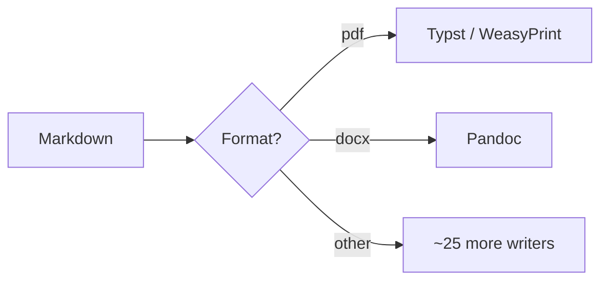

# Introduction

This file exercises most of what the converter handles. Send it through the UI
or with:

```bash
curl -u "$USER:$PASS" -F file=@examples/sample.md -F to=pdf \
  -F toc=true -o sample.pdf https://md.example.com/api/convert
```

Text supports *emphasis*, **strong emphasis**, `inline code`, ~~strikethrough~~
and footnotes.[^1]

[^1]: Footnotes land at the end of the document.

## Lists

- Unordered items
- With nesting
  - like this
- And task boxes:
  - [x] shipped
  - [ ] not yet

1. Ordered items
2. Also work

## Tables

| Region  | Q1     | Q2     | Change |
|---------|-------:|-------:|-------:|
| North   | 12,400 | 15,100 | +21.8% |
| South   |  8,900 |  8,200 |  −7.9% |
| Central | 21,050 | 24,600 | +16.9% |

## Code

```python
def convert(source: Path, fmt: str) -> Path:
    """Syntax highlighting comes from pandoc's highlighter."""
    return run_pandoc(source, fmt)
```

## Diagrams

Fenced `mermaid` blocks become real images when MERMAID_ENABLED is on:



## Quotes

> Anything pandoc understands in markdown works here — including block quotes,
> definition lists and raw HTML.

## Math

Inline math like $E = mc^2$ and display math both render:

$$
\int_{0}^{\infty} e^{-x^2}\,dx = \frac{\sqrt{\pi}}{2}
$$
